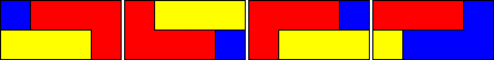

<div align="center">

# Tiling Solver

Exact tilings of rectangles by polyominoes, found by turning the puzzle<br>
into a system of linear and Diophantine equations over 0/1 variables.




<sub>The four tilings of a 2 × 4 rectangle with an L-tromino, a straight tromino and a monomino, as found by the solvers.</sub>

</div>

<br>

| | |
|---|---|
| Context | Personal research project (TIPE, French *classes préparatoires*), 2023-2024 |
| Question | Can a rectangle be tiled exactly by a given set of pieces, and in how many ways? |
| Methods | Exact-cover formulation, symbolic linear algebra, Diophantine equations, parity (colouring) argument |
| Language | Python; comments and console output are in French |

---

## Contents

- [Mathematical formulation](#mathematical-formulation)
- [Solvers](#solvers)
- [Usage](#usage)
- [Limitations](#limitations)
- [Credits and license](#credits-and-license)

---

## Mathematical formulation

Pieces are used once each and may be rotated and flipped.

1. Enumerate placements. For each piece, generate every rotation and reflection (the dihedral group of the square) and every translation that fits in the rectangle. Each placement is a 0/1 matrix of the rectangle's size.
2. Introduce one variable per placement: `x_k = 1` if placement `k` is used, `0` otherwise.
3. Write the exact-cover constraints:

   | Constraint | Equation |
   |---|---|
   | each cell is covered exactly once | `Σ_k a_k(cell) · x_k = 1` |
   | each piece is used exactly once | `Σ_{k ∈ piece} x_k = 1` |

   This gives a linear system `A x = b` whose 0/1 solutions are exactly the tilings.
4. Check parity first. Colour the rectangle like a chessboard. Each piece covers a fixed imbalance between black and white cells (its parity), and so does the rectangle. Combining piece areas and parities through Diophantine equations proves, for some instances, that no tiling exists: the solver then stops immediately (total parity violation).

## Solvers

| Script | Method | Output |
|---|---|---|
| [`2D_All_tilings_linear_system.py`](2D_tilings/All_tilings/2D_All_tilings_linear_system.py) | Solves `A x = b` symbolically with SymPy, then enumerates the free parameters and keeps the 0/1 solutions | all tilings |
| [`2D_All_tilings_linear_system_connexity_check.py`](2D_tilings/All_tilings/2D_All_tilings_linear_system_connexity_check.py) | Same, with connectivity pruning: a placement is discarded if it leaves an empty region smaller than the smallest other piece, or more empty regions than there are other pieces | all tilings |
| [`2D_All_tilings_diophantine_equations.py`](2D_tilings/All_tilings/2D_All_tilings_diophantine_equations.py) | Rewrites the constraints as Diophantine equations and enumerates their 0/1 solutions | all tilings |
| [`2D_Fast_tiling_diophantine_equations.py`](2D_tilings/First_tiling/2D_Fast_tiling_diophantine_equations.py) | Diophantine formulation without solving the full system, stops at the first tiling | one tiling |

All solvers run the parity check first and save each tiling as a PNG (in `Output/` for the exhaustive solvers, in the working directory for the first-solution solver).

On the 2 × 4 example above, the three exhaustive solvers agree on the same four tilings. The Diophantine solver finishes in about 0.01 s and the symbolic linear-system solver in about 4 s.

## Usage

```bash
git clone https://github.com/bilal-jaiel/polyomino-tiling-solver.git
cd polyomino-tiling-solver
pip install -r requirements.txt
```

Each script ends with example calls to `paving(rows, cols, pieces)`. Uncomment one or add your own, then run the script. Pieces are 0/1 matrices where `1` marks a square of the piece:

```python
L  = [[1, 0],
      [1, 0],
      [1, 1]]         # L-tromino
I3 = [[1], [1], [1]]  # straight tromino
C  = [[1]]            # monomino

paving(2, 4, [L, C, I3])   # tile a 2 x 4 rectangle with these three pieces
```

```bash
python 2D_tilings/All_tilings/2D_All_tilings_diophantine_equations.py
```

The exhaustive solvers pause before displaying the solutions and wait for Enter.

## Limitations

- The number of placements, and therefore of variables, grows quickly with the rectangle and the number of pieces. The 5 × 5 example with seven pieces in `2D_Fast_tiling_diophantine_equations.py` already gives 260 variables and 32 equations, and did not finish within 5 minutes in our test.
- Only rectangles are handled in the current code, although the formulation applies to any finite region of the grid.
- The scripts share much of their code (transformations, parity check, plotting); it could be factored into one module, with a command-line interface instead of editing the example calls.
- An extension to 3D tilings (polycubes) was planned but is not implemented.

## Credits and license

The parity search (`pv_search`) and the Diophantine helpers (`diophantine_nd_nonnegative`, `diophantine_nd_positive`, `diophantine_nd_01`) are adapted from code by Marcus R. Garvie and John Burkardt, distributed under the MIT license; their author and license notes are kept in the source. Their tiling model was the starting point of this work.

Code by Bilâl Jaiel is released under [Creative Commons Attribution-NonCommercial 4.0](LICENSE). The third-party functions listed above remain under the MIT license.

---

<div align="center">
<sub>Bilâl Jaiel · <a href="https://github.com/bilal-jaiel">GitHub</a> · <a href="https://www.linkedin.com/in/bilal-jaiel/">LinkedIn</a></sub>
</div>
